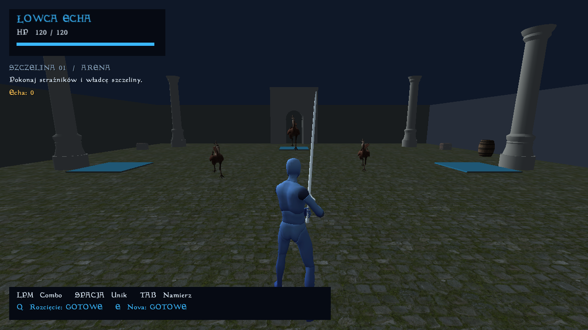

# Łowca Echa — prototyp na OpenMW

Samodzielny prototyp RPG akcji inspirowanego dynamiką *Solo Leveling: ARISE*. Korzysta z OpenMW **0.51.0**, własnej areny i Lua. Nie wymaga instalacji ani plików Morrowinda.

Projekt powstaje **niekomercyjnie**. Korzystamy z gotowych paczek modeli na warunkach ich licencji. Arena wykorzystuje kamienne elementy świątyni, miecz, topór, skrzynie, stojaki i beczki z OpenMW Example Suite (CC0); pochodzenie i dobór plików opisuje [ART_ASSETS.md](docs/ART_ASSETS.md).

Obecna wersja to techniczny prototyp walki: kamera zza pleców, namierzanie, trzy ciosy combo z buforem wejścia, unik z krótką nietykalnością, dwie zdolności, dwóch strażników i boss. Działają zakończenie wyprawy, licznik zdobytych ech, restart i zapis stanu. Postacie i animacje są zasobami zastępczymi z oficjalnego Example Suite; grafika nie jest docelowa.



**Windows 10/11 x64 — gotowa paczka**

Pobierz `LowcaEcha-Launcher-Windows-x64.zip` z [aktualnego wydania Windows](https://github.com/misza3444/morrowind/releases/tag/windows-latest), rozpakuj raz i uruchamiaj **`Graj.exe`**. Launcher automatycznie pobiera grę i kolejne aktualizacje. Jeśli masz starszą paczkę, rozpakuj mały ZIP launchera do istniejącego folderu gry, zastępując `Graj.exe`; zachowaj katalog `profile/`. Dostępny jest też pełny `LowcaEcha-Windows-x64.zip` do pierwszej instalacji bez pobierania gry przez launcher. Wyniki budowania pozostają również w [GitHub Actions](https://github.com/misza3444/morrowind/actions/workflows/build.yml) i lokalnym `dist/`.

Aktualizacje korzystają z publicznych GitHub Releases i nie wymagają logowania. Pobierają tylko zmienione paczki; przy zmianach gry silnik jest używany ponownie. Nowa wersja jest sprawdzana przed przełączeniem, a zapisy i ustawienia pozostają w `profile/`. `Graj.exe --offline` uruchamia grę bez sieci, a `Graj.exe --rollback` przywraca poprzednią zainstalowaną wersję. Szczegóły: [UPDATES.md](docs/UPDATES.md).

Do grania nie są potrzebne Python, Git ani Morrowind. Wymagane są .NET Framework 4.8 (wbudowany w Windows 10 od wersji 1903 i Windows 11) oraz sterownik grafiki obsługujący OpenGL 3.3 lub nowszy.

Paczka zawiera silnik i biblioteki Visual C++ z oficjalnego wydania OpenMW. Nie uruchamia instalatora administratora ani nie zmienia systemowej instalacji OpenMW. Natywny launcher obsługuje spacje i polskie znaki w ścieżkach. Zapisy i ustawienia znajdują się w `profile/` obok gry; ustawienia użytkownika są zachowywane między uruchomieniami. Instrukcja i polecenia deweloperskie: [WINDOWS.md](docs/WINDOWS.md).

**Linux x86_64 — środowisko deweloperskie**

Wymagania: Python 3.12+, Git i Git LFS. Do testów bez ekranu potrzebny jest Xorg z modułem `dummy` i Mesa; są dostępne w obecnej maszynie. Zrzuty ekranu korzystają z polecenia `import` programu ImageMagick. Pakiet silnika pobierany jest z oficjalnego wydania GitHub i sprawdzany przez SHA-256; zasoby LFS są przypięte do konkretnego commitu i weryfikowane.

```sh
cd /workspace/morrowind
python3 tools/setup.py
python3 tools/run.py
```

Druga komenda startuje natywną grę, gdy dostępny jest ekran. Bez `DISPLAY` tworzy prywatny ekran wirtualny do pracy w chmurze. Nie udostępnia podglądu w przeglądarce.

```sh
# Pełne testy integracyjne w rzeczywistym OpenMW, wraz z zapisem i wczytaniem.
python3 tools/run.py --test --headless

# Rzeczywisty kadr z gry; po zapisaniu obrazu procesy są zatrzymywane.
python3 tools/run.py --headless --capture build/echo-arena.png
```

Testy uruchamiają się na osobnym profilu i nie modyfikują zapisów zwykłej gry. Czysta instalacja wymaga sieci; późniejsze uruchomienia i testy działają na pobranych plikach. `tools/setup.py` i `tools/run.py` obsługują także Windows x64; wirtualny ekran i zrzuty przez `--capture` są narzędziami Linuksa.

**Sterowanie**

| Przycisk | Działanie |
| --- | --- |
| WASD / mysz | Ruch / obrót kamery |
| Lewy przycisk myszy | Cios; kolejne kliknięcie kolejkuje następny cios combo |
| Spacja + kierunek | Unik; bez kierunku unik do przodu |
| Tab | Namierz najbliższego widocznego przeciwnika / zwolnij cel |
| Q | Rozcięcie przed bohaterem, odnowienie 5 s |
| E | Nova wokół bohatera, odnowienie 9 s |
| R | Rozpocznij nową wyprawę, zachowując zdobyte echa |
| F6 / F7 | Zapis / wczytanie punktu zapisu |
| Esc | Menu silnika |

Umiejętności i unik korzystają z czasu symulacji; pauza zatrzymuje odnowienie. Ataki sprawdzają odległość, kierunek oraz przeszkody. W tym prototypie obrażenia umiejętności są natychmiastowe, a combo używa określonych okien czasowych. Unik korzysta z normalnego ruchu i fizyki silnika, z czasowo zwiększoną szybkością. Nie jest teleportacją.

**Pliki projektu**

- `game/scripts/echo/`: reguły walki, sterowanie, HUD, zachowanie przeciwników, stan wyprawy i zapis.
- `tools/build_content.py`: generator dodatku `.omwaddon`, areny, modeli COLLADA i tekstur zastępczych. Wygenerowany dodatek można otworzyć w OpenMW-CS z szablonem jako plikiem nadrzędnym.
- `dependencies.lock.json`: przypięte wydanie silnika, suma kontrolna i commit zasobów.
- `assets/manifest.json`: wybrane modele i tekstury gotowej paczki, źródło, licencja i SHA-256; generator kopiuje je do budowanej gry.
- `packaging/windows/`: źródło `Graj.exe`, aktualizatora .NET i programu uruchamiającego silnik; `tools/package_windows.py` buduje pełny ZIP, mały launcher i dwie paczki aktualizacji z SHA-256.
- `tests/engine/`: testy wykonujące kod gry w prawdziwym silniku; ich skrypty nie są ładowane podczas zwykłej gry.
- `.runtime/`: pobrany silnik, zasoby oraz oddzielne profile gry i testów; katalog pomijany przez Git.
- `build/data/`: generowana zawartość, odtwarzana z kodu przy każdym uruchomieniu.
- `.github/workflows/build.yml`: testy narzędzi i aktualizatora, kompilacja oraz sprawdzenie launchera ze ścieżką Unicode, regresja gry na Linuksie i publikacja GitHub Releases po udanych testach.

Log zwykłej gry: `.runtime/profile/openmw.log`. Zapisy: `.runtime/profile/user/saves/`. Log testów: `.runtime/test-profile/openmw.log`. Wczytanie konkretnego pliku: `python3 tools/run.py --load /pełna/ścieżka/do/pliku.omwsave`.

Sprawdzone zachowania i granice weryfikacji opisuje [VALIDATION.md](docs/VALIDATION.md). Założenia techniczne i źródła znajdują się w [rozeznaniu](docs/ROZEZNANIE_OPENMW.md), a licencje zależności w [THIRD_PARTY.md](THIRD_PARTY.md).

Dalsza praca obejmuje docelową postać i animacje, efekty oraz dźwięki umiejętności, lepsze sygnalizowanie ataków bossa i przywoływanego wojownika. Zdobyte echa są obecnie licznikiem nagród; nie ma jeszcze drzewka rozwoju, ekwipunku z łupów, kampanii ani multiplayera.
